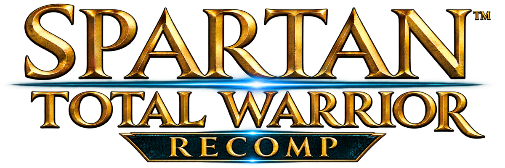
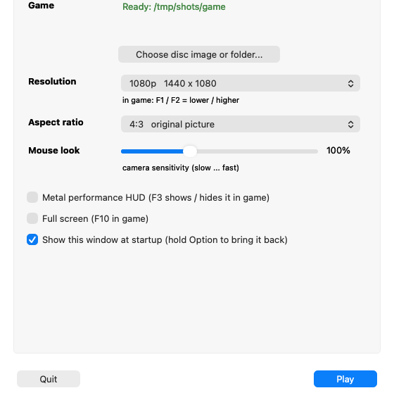
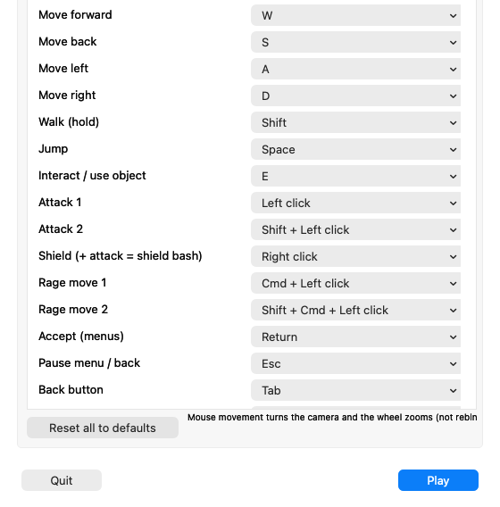
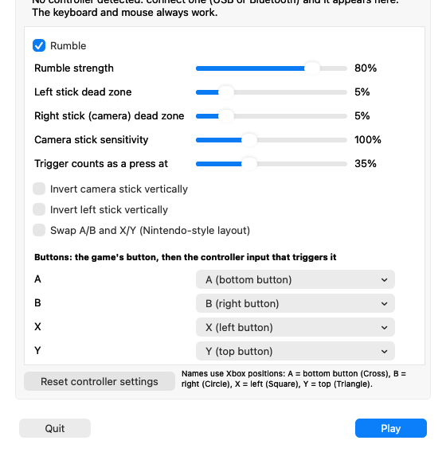
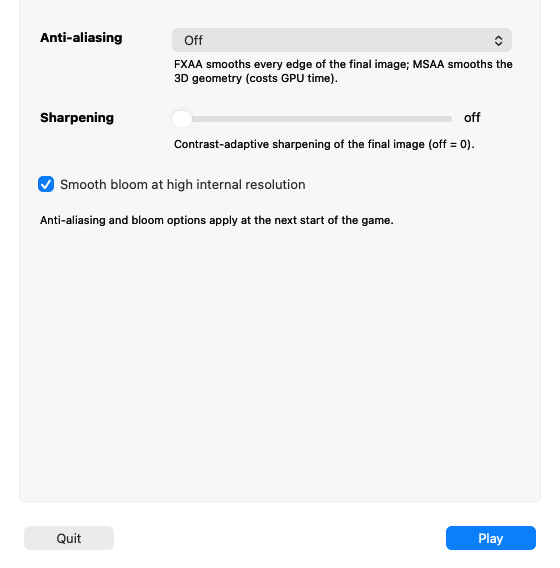
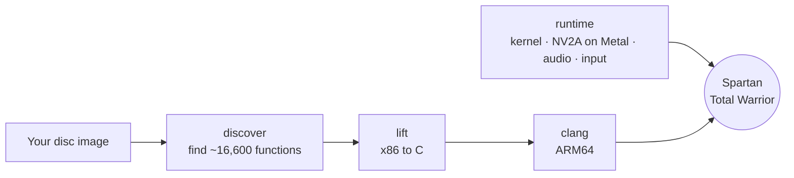

<p align="center">
  
</p>

<p align="center">
  <b>The original Xbox game, running natively on your Apple Silicon Mac.</b><br>
  Not an emulator: the game's own code is recompiled on your machine.
</p>

<p align="center">
  <a href="https://github.com/ze-castro/spartan-total-warrior-recomp/releases/latest"></a>
  
  
  <a href="LICENSE"></a>
</p>

<p align="center">
  <a href="#-install">Install</a> ·
  <a href="#-features">Features</a> ·
  <a href="#-controls">Controls</a> ·
  <a href="#-build-from-source">Build</a> ·
  <a href="#-known-issues">Known issues</a> ·
  <a href="#-documentation">Docs</a>
</p>

---

> [!IMPORTANT]
> **You need your own copy of the game.** This repository and its downloads contain no game code, no assets, and nothing generated from them.
> You supply a disc image of the Xbox **PAL / Europe** release that you own, and the app translates it on your Mac. Not affiliated with or
> endorsed by SEGA, Creative Assembly, Microsoft or anyone else. *Spartan: Total Warrior* is a trademark of its owners.

## ⚔️ What is this?

**Spartan: Total Warrior** (Creative Assembly, 2005) is a hack-and-slash for the original Xbox. This project is a *static recompilation*: the game's
x86 machine code is translated to C once, compiled for Apple Silicon, and run against a small re-implementation of the console underneath
(kernel, the NV2A GPU drawn with Metal, audio on CoreAudio, controllers and files). No console emulation sits between the game and your CPU, which
is why it runs at a steady 60 frames per second and can render far above the Xbox's 480 lines.

## ✨ Features

| | |
| --- | --- |
| **Native speed** | the game's code runs as native ARM64; about 55–60 fps in menus, cutscenes and the first areas on an M-series Mac |
| **Resolution** | Original (480 lines), 720p, 1080p, 1440p or 2160p, with 8x anisotropic filtering; change it live with `F1` / `F2` |
| **Widescreen** | a real 16:9 view built by the game itself, with the HUD kept in proportion (or the original 4:3) |
| **Image quality** | FXAA or 2x / 4x MSAA, contrast-adaptive sharpening, smoother bloom |
| **Controls** | keyboard and mouse with **every action rebindable**, plus full controller support (Xbox, PlayStation, Switch) with rumble |
| **Launcher** | pick your disc, resolution, aspect ratio, mouse sensitivity, Metal performance HUD and full screen before the game starts |
| **Complete package** | intro movies, cutscenes, audio, saving and loading all work |
| **Downloadable app** | a normal `.app`: open it, point it at your disc, and it prepares the game for your Mac on the first run |

<table>
  <tr>
    <td align="center"><br><sub>Display, resolution and aspect ratio</sub></td>
    <td align="center"><br><sub>Every keyboard and mouse action is rebindable</sub></td>
  </tr>
  <tr>
    <td align="center"><br><sub>Controller mapping, dead zones and rumble</sub></td>
    <td align="center"><br><sub>Anti-aliasing, sharpening and bloom</sub></td>
  </tr>
</table>

## 📦 Install

**What you need:** macOS 13 or later on Apple Silicon, the Xcode command line tools (`xcode-select --install`), and your own PAL disc image
(`.iso`) of the game. About 12 GB of free disk space.

1. Download the latest `.dmg` (or `.zip`) from the [**Releases**](https://github.com/ze-castro/spartan-total-warrior-recomp/releases/latest) page and drag the app to *Applications*.
2. The app is not signed by an Apple developer account. The first time, **right-click the app and choose Open**, then **Open** again. (Or run
   `xattr -dr com.apple.quarantine "/Applications/Spartan Total Warrior.app"`.)
3. Open it and choose your disc image. The first run prepares the game for your Mac, which takes about 5 minutes, once.
4. Press **Play**.

Your disc image stays where it is. The game files and your saves live in `~/Library/Application Support/Spartan Total Warrior Recomp/`.

## 🎮 Controls

All keyboard and mouse controls can be changed in the launcher's **Controls** tab. Defaults:

| Action | Default | | Action | Default |
| --- | --- | --- | --- | --- |
| Move | `W` `A` `S` `D` | | Attack 1 | left click |
| Walk | hold `Shift` | | Attack 2 | `Shift` + left click |
| Jump | `Space` | | Shield | right click |
| Interact | `E` | | Rage moves | `Cmd` + left click, `Cmd` + `Shift` + left click |
| Camera | mouse | | Zoom | scroll wheel |
| Accept | `Enter` | | Pause / back | `Esc` |

**In game:** `F1` / `F2` lower / raise the resolution · `F3` Metal HUD · `F10` full screen · `Cmd+Q` quit.
On a Mac the `F` keys act as media keys unless you hold `fn`.

> [!TIP]
> If `Enter` does not respond on a menu, in a cutscene or on the death screen, press **`Esc`**: it sends Start during a scene and goes back in
> menus. `Shift+Enter` also sends Start.

The full list, including controllers, is in [docs/CONTROLS.md](docs/CONTROLS.md).

## 🛠️ Build from source

```sh
git clone https://github.com/ze-castro/spartan-total-warrior-recomp.git
cd spartan-total-warrior-recomp
scripts/prepare.sh "/path/to/Spartan - Total Warrior (Europe).iso"   # once: extract, analyse and translate the game (a few minutes)
make                                                                  # compile into build/stw (a couple of minutes)
./build/stw                                                           # opens the launcher
```

To build the downloadable app (`.app`, `.zip`, `.dmg`): `scripts/make_app.sh`. Details and troubleshooting: [docs/BUILDING.md](docs/BUILDING.md).

## ⚙️ How it works



1. `tools/discover.py` finds the functions in the game's executable and `tools/oovpa_match.py` names the statically linked Xbox library functions.
2. `tools/lift.py` translates every function to C (the integer, x87, SSE and MMX instructions the game uses). Hardware-facing library functions
   are replaced by hand-written handlers.
3. `runtime/` supplies the machine: kernel calls and threads, an NV2A GPU model whose push-buffer commands become Metal draws (vertex programs and
   register combiners are translated to Metal shaders), a DirectSound mixer, XInput and the file system.

More in [docs/ARCHITECTURE.md](docs/ARCHITECTURE.md).

## 🐞 Known issues

This is a first release; see [RELEASE_NOTES.md](RELEASE_NOTES.md) for the full list. The important ones:

* `Enter` sometimes doesn't register on menus, in cutscenes or on the death screen: use `Esc` (see above).
* The glowing ring in front of treasure chests is missing.
* Only the early game has been played through. Act 2 and later, boss fights and the other arena modes are untested.
* Real game controllers and heavy combat scenes (performance) have not been tested.
* Only the PAL release is supported.

Found something else? [Open an issue](https://github.com/ze-castro/spartan-total-warrior-recomp/issues) and attach the log from
`~/Library/Application Support/Spartan Total Warrior Recomp/stw.log`.

## 📚 Documentation

| | |
| --- | --- |
| [Building](docs/BUILDING.md) | prepare, build, run, the app bundle |
| [Controls](docs/CONTROLS.md) | keyboard, mouse, controllers, rebinding |
| [Widescreen](docs/WIDESCREEN.md) | how 16:9 works and its limits |
| [Architecture](docs/ARCHITECTURE.md) | the translator and the runtime in detail |
| [Debugging](docs/DEBUGGING.md) | environment variables, frame dumps, how to test changes |
| [Status](docs/STATUS.md) | what works, what does not, ideas |

## 🤝 Contributing

Contributions are welcome. Read [CONTRIBUTING.md](CONTRIBUTING.md) first; the main rules are *never commit anything derived from the game*, and
*check the picture, not only the numbers*, since a performance change once left the whole screen black while the benchmarks looked fine.

## 📄 License

The code in this repository is released into the **public domain** under the [Unlicense](LICENSE). That covers this repository's code only, never
the game. Third-party material and how it is used is listed in [THIRD_PARTY.md](THIRD_PARTY.md).

---

<p align="center"><sub>Made by <a href="https://github.com/ze-castro">ze-castro</a> · Fan project, not affiliated with the game's owners.</sub></p>
